First, i trust everyone is safe.

i've worked across music, virtual reality, chips, consumer and professional electronics, HealthTech and DefenseTech, with time at Apple, Microsoft and IBM along the way. Two-time co-founder, two exits.

The code is here. The thinking is at **[tedtanner.org](https://www.tedtanner.org/)**: essays on computation, physics, the water, and the Infinite Human Do-Loop.

### Recent essays

<!-- recent:start -->
- [The Denominator (aka The Meter Was Always Running In Joules)](https://www.tedtanner.org/the-denominator-aka-the-meter-was-always-running-in-joules/) October 2026
- [Motivation Vs Discipline](https://www.tedtanner.org/motivation-vs-discipline/) September 2026
- [9.11.2026](https://www.tedtanner.org/9-11-2026/) September 2026
- [Return To The Analog (aka Life Is Not Band-Limited)](https://www.tedtanner.org/return-to-the-analog-aka-life-is-not-band-limited/) August 2026
- [No Coach at Depth: The Autodidactic Universe](https://www.tedtanner.org/no-coach-at-depth-the-autodidactic-universe/) August 2026
<!-- recent:end -->

### SnakeBytes

Short, working Python on one idea at a time.

<!-- snakebytes:start -->
- [SnakeByte\[23\]: Maynard-Cross Learning (MCL): Hive Minds as a Single RL Agent](https://www.tedtanner.org/snakebyte23-maynard-cross-learning-mcl-hive-minds-as-a-single-rl-agent/) September 2026
- [SnakeByte\[22\]: MegaParse (An LLM’s Dream Parser with No Bits Left Behind)](https://www.tedtanner.org/snakebyte22-megaparse-an-llms-dream-parser-with-no-bits-left-behind/) October 2025
- [SnakeByte\[21\]: The Token Arms Race: Architectures Behind Long-Context Foundation Models](https://www.tedtanner.org/snakebyte21-the-token-arms-race-architectures-behind-long-context-foundation-models/) July 2025
- [SnakeByte\[20\] Fractals Fractals Everywhere](https://www.tedtanner.org/snakebyte20-fractals-fractals-everywhere/) April 2025
- [SnakeByte\[19\] – Software As A Religion](https://www.tedtanner.org/snakebyte19-software-as-a-religion/) January 2025
<!-- snakebytes:end -->

### Elsewhere

[X @tctjr](https://x.com/tctjr) &nbsp;&nbsp; [LinkedIn](https://www.linkedin.com/in/theodoretanner/) &nbsp;&nbsp; [Keybase](https://keybase.io/tctjr) &nbsp;&nbsp; [Hacker News](https://news.ycombinator.com/user?id=tctjr)

Charleston, South Carolina. Views here are my own and represent no organization.

\#iwishyouwater
